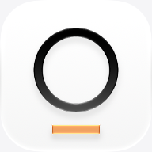

<div align="center">
  

# Furmony Gallery

Every Furmony adoption, on one page.

The studio's whole listing on a phone: what is open, what it costs, and when it changes.
</div>

<p align="center">
  <a href="https://wanderingmeow.github.io/furmony-gallery/"><strong>Open the gallery</strong></a> •
  <a href="https://wanderingmeow.github.io/furmony-gallery/stats"><strong>Market stats</strong></a> •
  <a href="https://furmony.com"><strong>The studio</strong></a> •
  <a href="https://github.com/wanderingmeow/furmony-gallery/issues"><strong>Report a problem</strong></a>
</p>

<p align="center">
  Unofficial field guide. Orders go to the official site.<br />
  
</p>

## About

> A listing dropped at 9am and you found out at noon?
> The official site stalls on a phone?
> **This is the guide.**

_Furmony Gallery_ is a **static site** that reads the public listing of [Furmony](https://furmony.com), a Chinese studio that makes fursuits from kemono to mixed styles, and puts the whole thing in **one feed** that opens fast on a phone.

- **One feed.** A virtualized waterfall on **SolidJS**: no virtual tree to diff, and only the cards on screen are in the document. The official site draws its thumbnails from the full-size picture, so the 22 covers above the fold cost 14.05 MB there and 1.01 MB here.
- **Search by meaning and by picture.** **Enhanced search** turns the box into a sentence: `a small dragon that loves meat` returns the listings that show it, and none of those words has to appear on a listing. The picture button beside the box takes a convention snapshot or a design draft and returns the listings that look like it. Both run on an embedding model, and the panel turns them on.
- **Installment prices.** Full price, 12 monthly payments, or no price, on every card and detail page at once.
- **Market stats.** `/stats` charts price distribution, colors, species, and new listings per month.
- **Similar listings.** Covers close to the one you are reading, with a back button that returns in the order you came.
- **Owner accounts.** X, Bilibili, TikTok, Douyin, and Xiaohongshu handles, collected by hand.
- **Debut photos.** The day a suit first appeared, read from the studio's own album on Bilibili or its finished-commission post on X, and matched to the listing it became. Set beside the design sheet, they show what the studio does between a flat drawing and a suit you can wear.
- **Four languages.** 简体中文, 繁體中文, 日本語, English. Where the studio's own words did not come in yours, the description arrives machine-translated, and the original stays a tap away.

Thinking about **buying**? The parts that matter first:

- The status row reads **Open**, **Lock in progress**, **Locked**, or **Adopted**. A hold lasts 15 minutes and most of them lapse unpaid; a lock is a paid deposit.
- A listing with debut photos is already adopted: the studio posts that album on the day the suit goes to its owner, so this site reads **Adopted** while the official flag still says open.
- **Debut photos only** keeps the suits with a photo from their first outing.
- Push tells you when a listing appears, a lock changes, or the full price moves.

No account, no analytics. It opens in Safari or Chrome as it is. Adding it to the Home Screen is only for notices: iPhone and iPad deliver Web Push to an installed web app.

## Notifications

A notice arrives before you think to refresh: a new listing, a lock change, or a price move.

Web Push carries the three things worth interrupting somebody for: a listing appears, a lock state changes, the full price moves. Tapping a notice opens that listing. The bell in the corner holds the same list with a count.

Sending push needs a server that holds subscriptions and watches the official API. That service, and the one behind enhanced search, live outside this repository. Subscribing is opt-in, and the browser prompt never appears before you ask.

## Say it, or show it

_A sheep in wolf's clothing_ is a search. So is a snapshot.

Enhanced search is off by default and still beta: a wrong guess happens now and then. Turn it on in the panel, and the search box takes a whole sentence. Listings whose name, description, number, or owner account contains the words come first; the model's nearest matches follow. The photo icon next to the box searches by image alone, with no text layer.

The service keeps nothing. Text and images are used in memory to answer the request and are dropped once the response is sent.

## When the one you wanted is locked

A lock means sold. Cards and the detail page show one word for the status, and a lock beside the name.

Two ways forward from a locked listing:

- **Similar listings** shows what sits close to it, with a back button that returns in the order you came.
- **Unlocked only** hides the locked and adopted listings.

## Opens on 3G

Measured in November 2026 on the same network, counting every byte the browser pulls before the first screen draws.



Three things get it there:

- **The document renders in one round trip.** The build inlines the CSS into the HTML, so the browser never waits for a second request. The gzipped document stays under 10 TCP packets. An inline script in `index.html` starts the list request while the document is still parsing.
- **Covers are resized at the URL.** The originals are often 1 MB PNGs. Every image URL carries Tencent COS `imageMogr2` parameters that scale to the box, convert to WebP, and strip metadata. The 22 covers above the fold went from 14.05 MB to 1.01 MB.
- **A service worker caches the shell.** `precache.json` is the single list of what to keep. The second visit pulls about 0.5 MB (only the whole listing from API), and the app opens with the cached list when the network is unreachable.

## Run it

```bash
npm install
npm run dev        # http://localhost:5173/furmony-gallery/
npm test           # offline: mocked APIs, happy-dom, fake-indexeddb
npm run build      # dist/, plus dist/404.html for GitHub Pages SPA fallback
npm run lint       # eslint
npm run format     # prettier
```

The browser talks to the official public API directly. No account, no proxy.

In dev mode, `src/data/api.ts` prefers `agent/listings_sample.json` and `agent/series_sample.json` when they exist, and falls back to the live API when they do not. `agent/` is not committed, and none of that reaches `dist/`.

Three files are generated and are not authored by hand:

- `public/socials.json` carries the owner accounts of each listing, and `public/debuts.json` carries the photos of its debut day. Both are written off this machine, from the studios' own posts, and the tables they are read from name real accounts, so neither the tables nor the scripts that fill them in are published here. The published branch carries the two files: a machine without them builds a site with no owner chips and no debut album, and nothing else breaks.
- `public/related.json` is built nightly by the search service from fresh cover images. Nothing in the repository generates it locally. A missing file hides the similar row and breaks nothing else.

## Data and privacy

- Owner accounts and debut photos are collected by hand, one listing at a time. A model can read a studio post and pick the pictures out of it, and its accuracy is not high enough yet to publish what it finds unchecked.
- Want your listing kept out of the owner accounts or the debut photos? [Open an issue](https://github.com/wanderingmeow/furmony-gallery/issues) and it is removed.
- Listing and image data live in IndexedDB. Filters, likes, price display mode, and scroll position live in localStorage. A storage warning appears when the browser refuses to keep them.
- With enhanced search off, no queries leave the device. Turning it on sends only what you type or pick.
- The search service keeps nothing: no logs of queries, no images retained.

## Stack

[SolidJS](https://solidjs.com) and TypeScript, with [@solid-primitives/i18n](https://github.com/solid-primitives/solid-primitives) and [@solidjs/router](https://github.com/solidjs/router) · [Vite](https://vite.dev) · [Tailwind CSS](https://tailwindcss.com) v4 · [@panzoom/panzoom](https://github.com/anvaka/panzoom) for full-screen zoom · [uPlot](https://github.com/leeoniya/uPlot) for the charts · [Ant Design icons](https://ant.design) · [Vitest](https://vitest.dev) with happy-dom and fake-indexeddb.

## Credits and license

[MIT](LICENSE). All images and text belong to Furmony (furmony.com) and their original authors. This site only reads material the official site already publishes, and takes no commercial use of it.

Built by a long-horizon coding agent on a local machine, along with a human who care about user experience.
